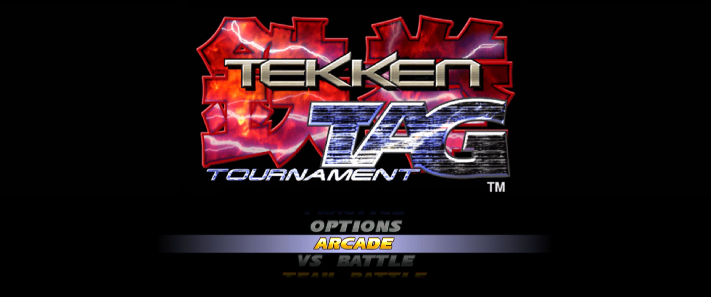
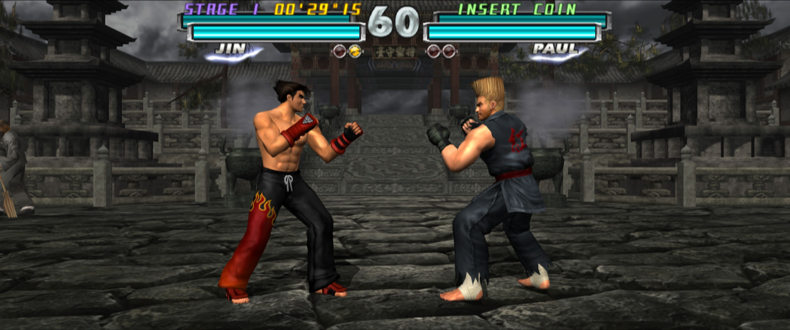
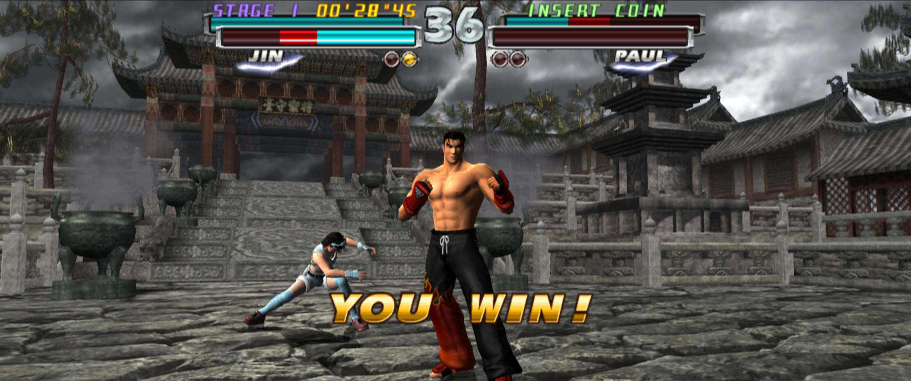

# Tekken Tag Tournament Widescreen Fix
Widescreen fix for Tekken Tag Tournament (PS2, NTSC-U, SLUS-20001, CRC 67454C1E).

Compatible with: [PCSX2 fork with plugins](https://github.com/ASI-Factory/PCSX2-Fork-With-Plugins)

## Features
- Support any aspect ratio and live resizing.
- Hor+ camera.
- Proportional HUD and menus.
- Optional intro skip.

## Screenshots

## Requirements
- Windows and the latest PCSX2 fork with plugins.
- Aspect ratio set to **Stretch** in the emulator.

## Download:
Download the latest archive from the [releases](https://github.com/gennariarmando/PCSX2F-TTT-WidescreenFix/releases) page.

## Installation
1. Copy `PCSX2F-TTT-WidescreenFix.elf` and `PCSX2F-TTT-WidescreenFix.ini` to the `plugins` folder of the emulator.
2. Start the game.

## Building
Requirements: Visual Studio 2026 with the C++ workload, PowerShell and git.

1. Clone with submodules:\
   `git clone --recursive https://github.com/gennariarmando/PCSX2F-TTT-WidescreenFix.git`.
3. Run `premake5.bat`. It generates `project_files/PCSX2F-TTT-WidescreenFix.slnx`.
4. Optional: set `PCSX2_FORK_DIR` to the emulator folder so every build copies the plugin to its `plugins` folder and F5 starts the emulator.
5. Open the solution and build. The plugin is written to `output/plugins/PCSX2F-TTT-WidescreenFix.elf`.

Without Visual Studio, `tools/build.ps1` runs the same PS2 compiler step.
